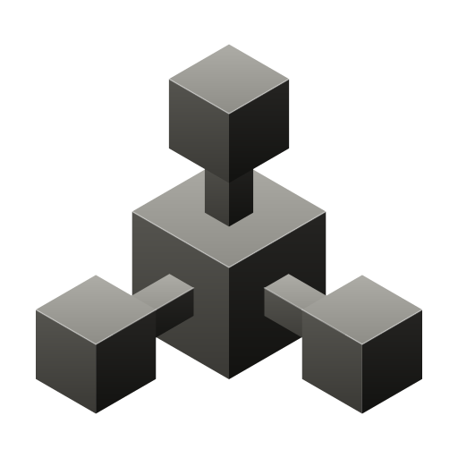

<picture>
  <source media="(prefers-color-scheme: dark)" srcset="web/brand/mark-dark.svg">
  
</picture>

# Beerus

Beerus is a full simulation of the Nigerian banking system that runs on your own infrastructure. It lets developers send transfers, post charges, settle between banks and share account data through open banking, with each step behaving the way it does in production.

## What it models

- **Banks** with double-entry core ledgers, internet banking with 2FA, charges, VAT and stamp duty, reversals and end-of-day processing.
- **NIBSS**: the NIP switch with name enquiry, transfers and status queries, deferred net settlement in sessions, the BVN registry, the Open Banking Registry and the consent ledger.
- **CBN**: the trust anchor for every participant's certificates, and the RTGS that holds banks' settlement accounts.
- **Beerus Connect**: an open banking aggregator. Applications connect through its partner API to get account data and a transaction feed.
- **Control API and CLI**: create customers and accounts, take deposits and withdrawals, send transfers and inject faults. Banks start empty, and money moves only when you or your app move it.

Each institution is a separate service with its own database. They communicate only over mTLS with signed, idempotent messages, as they would in production.

## Time

Business time is real Lagos time. Nobody can move the clock of NIBSS or the CBN, so Beerus cannot either. Settlement and status queries run when real time reaches them, or when you run `beerus nip settle-now` or `beerus nip status <session_id>`.

## Standards

Open banking follows the CBN Operational Guidelines for Open Banking (March 2023): FAPI 2.0, mTLS, certificate-bound tokens, time-bound consent and a central registry. Interbank messages follow the structure of ISO 20022. These controls are enforced in every environment, including local development.

## License

Beerus is distributed under the terms in [COMMERCIAL-LICENSE.md](COMMERCIAL-LICENSE.md).
